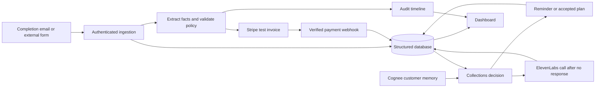

# Due — Hackathon PRD and Parallel Build Tasks

Status: Ready for implementation planning  
Owners: Ammad and teammate  
Event: Briefcase × Stripe, 15 October 2026, London  
Track: Agents that collect  
Working product name: Due  
Scope: A hackathon demonstration using synthetic customer data and Stripe test mode

## 1. Product goal

Build an accounts-receivable agent for service businesses that turns evidence of completed work into an invoice, explains every charge, and adapts payment follow-ups to customer promises and disputes.

**Pitch:** From completed work to collected payment—an agent that explains every charge and remembers every promise.

The demonstration must establish that a real incoming event caused the agent to create a real Stripe test-mode invoice without a human raising or approving that invoice. A valid automatic billing path and an understandable audit trail take priority over feature breadth.

## 2. Hackathon requirements and scoring

| Requirement | Product response | Evidence required in the demo |
| --- | --- | --- |
| Real-world trigger | An inbound completion email, or an actual service-completion event from a small external form | Incoming event and its source are visible |
| Real bill in Stripe test mode | Agent creates and finalises an invoice through the Stripe API | Open the actual invoice in Stripe and show its ID |
| No human raises the bill | A valid event automatically progresses through validation and invoice creation | No approval or “create invoice” click on the successful path |
| Works end to end: 35 points | Trigger → invoice → test payment → reconciled balance | Stripe state agrees with our dashboard |
| Autonomy with control: 25 points | Written policy, deterministic validation, duplicate protection, disputes and promises | Show one successful action and one blocked or deferred action |
| Explains every pound: 20 points | Source references, exact calculation, policy version and action result | Expand an invoice line and inspect its evidence |
| Product and creativity: 20 points | Collections respond to customer context | A promise changes the next follow-up |
| Optional Cognee side quest | Retrieve customer memory before making a collections decision | Show retrieved evidence and the decision it changed |

Event rules: teams of up to four; project implementation starts at 18:00 London time; planning and reading docs beforehand are allowed; pre-18:00 commits are visible to judges. Stripe test mode only. Submit a public GitHub repository and a publicly viewable video of at most two minutes between 18:00 and 21:00. One submission per team. Finalists must be present for 21:35 demos.

These are requirements to meet, not a guarantee of eligibility or a judging score. Check any briefing updates at the event.

## 3. Users and primary scenario

The operator is a small agency or consultancy that already records customers, agreed prices and completed services. The customer is a business receiving invoices and payment follow-ups.

Seed one synthetic customer, Acme, with an agreed £1,200 website-migration milestone. Use a deliberately simple tax configuration, explicitly marked as a demo assumption; do not imply production VAT handling.

1. A completion email or external service event identifies the customer and milestone.
2. The agent extracts the relevant facts and evidence references.
3. The system looks up the authoritative customer, contract, milestone price and billing policy.
4. Deterministic checks confirm completion evidence, known price, customer match, policy limit and absence of an existing bill.
5. The agent automatically creates and finalises a Stripe test-mode invoice.
6. The dashboard shows the invoice, hosted payment URL, amount and supporting evidence.
7. A clearly labelled simulated application clock demonstrates an overdue follow-up.
8. No reply arrives within 24 application-clock hours after a successfully delivered reminder. A fresh eligibility check triggers an ElevenLabs call.
9. The customer promises payment during the call. Its source-linked outcome is stored and the next reminder is deferred. A separate reply-before-call scenario proves that a response cancels the queued call.
10. A Stripe test payment updates the remaining balance and cancels pending collections actions.

A second scenario introduces a delivery dispute. The system pauses collections and opens a review item. A third replays the original completion event and proves that no duplicate invoice is created.

## 4. Scope and priority

### P0 — required to ship

- One working input adapter for actual incoming completion events.
- Seeded customers, contracts, milestones and explicit billing policy.
- Structured extraction of customer and completion facts with source references.
- Deterministic validation and automatic invoicing of the valid path.
- Real Stripe test-mode invoice, finalisation and hosted payment link.
- Payment reconciliation through verified Stripe webhooks, with a manual refresh recovery path.
- Duplicate-event and duplicate-milestone protection.
- Invoice detail and audit timeline in a single dashboard.
- Promise-aware deferral and dispute-aware pause in collections.
- One demonstrable reminder action delivered only to a team-controlled test destination, with delivery result recorded.
- ElevenLabs outbound call after an overdue customer fails to respond within the policy window; demo calls go to an allowlisted, consenting teammate.
- Call outcomes returned to the main system as source-linked promises, disputes, no-answer or review events.
- Synthetic seed data, repeatable demo procedure, public-repo preparation and submission assets.

### P1 — next priority

- Cognee ingestion and retrieval that materially affect collections decisions.
- A customer can accept a predefined, interest-free two-instalment proposal.
- Partial payment is attached to the original Stripe invoice and reconciled correctly.

Cognee should be pursued early because of its fit with the product and side quest, but a Cognee outage must not prevent the core invoicing demonstration. If memory retrieval is unavailable, show that state honestly and use canonical structured records for safe collections decisions. Do not claim Cognee is functioning when a fallback supplied the result.

### P2 — after the event

- Production Gmail/Outlook integrations and historical inbox import.
- Multiple organisations, currencies, tax regimes and accounting integrations.
- Configurable late fees and interest after contractual and jurisdictional review.
- Production telephony consent, identity verification, permitted hours and retention policies.
- Advanced recurring billing, credit notes, refunds and reconciliation workflows.

Do not build a broad CRM, accounting suite, agent marketplace, general-purpose graph explorer or multi-agent orchestration product for this demo. One agent workflow with constrained tools is enough.

## 5. Functional requirements and acceptance criteria

### FR-01: Ingest evidence

Accept a completion event containing an external event ID, source type, source reference, received timestamp, customer reference and message or completion text. Persist the original evidence before processing.

**Acceptance:** an incoming event produces an audit entry and enters processing automatically. Re-delivery returns the original processing result. An event cannot select another organisation's customer.

For speed, implement an authenticated inbound webhook first. Connect either an email provider or a small separate service-completion form. The event reports completed work; it does not supply a trusted amount or instruct the system to raise a particular bill. Fixture replay is useful for development but must be labelled and cannot be the only evidence of the real-world trigger.

### FR-02: Extract facts and validate billing

The LLM returns structured candidate facts and evidence references. Code validates its output and resolves authoritative prices and customer IDs. Treat source text as data, including any text that attempts to change billing rules.

**Acceptance:** a known £1,200 milestone is billed at exactly 120000 GBP minor units. Missing prices, ambiguous customers, contradictory completion evidence or unsupported line items produce a review item and no Stripe invoice. Model-generated explanations cannot authorise a charge.

### FR-03: Create a real invoice autonomously

Create an invoice for the resolved Stripe customer, attach only that invoice's validated items, finalise it explicitly and persist the returned ID, status and hosted URL. Use `send_invoice` with an explicit due date or payment term. Do not depend on automatic finalisation delays.

**Acceptance:** the valid incoming event creates a finalised test-mode invoice without a human approval step. The dashboard links to the real object. The system refuses live-mode operation. A partial API failure can be retried without creating a second invoice or duplicate line item.

Invoice email delivery and invoice creation are separate outcomes. Verify test-environment email behaviour before relying on it. Use a team-controlled mail adapter if required and record actual delivery state; an `invoice.sent` event alone is not proof that a mailbox received a message.

### FR-04: Explain each action

Each decision records its evidence IDs, policy ID/version, validated calculation, decision code, timestamp, resulting external IDs and concise explanation.

**Acceptance:** “Why £1,200?” reveals the contract reference and accepted milestone. A deferred reminder points to the exact promise and date. Explanations describe recorded facts, not hidden model reasoning.

### FR-05: Reconcile payments

Verify Stripe webhook signatures, deduplicate event IDs and refresh the invoice from Stripe before updating canonical balances. Handle repeated or out-of-order events without regressing a paid invoice to unpaid.

**Acceptance:** a successful test payment updates the dashboard. A partially paid invoice retains its remaining balance. A fully paid invoice has zero outstanding balance and no executable pending reminder or call. Manual refresh repairs a missed webhook.

### FR-06: Make collections decisions

Evaluate outstanding balance, due date, existing promises, disputes, previous contacts and policy. Re-fetch Stripe state immediately before an external follow-up. An overdue invoice is determined from its due date and remaining balance; it is not the same as a failed card attempt.

**Acceptance:** before the due date, take no overdue action. After it, a valid future promise defers contact; a dispute pauses contact; payment cancels contact. With no blocker, send one permitted reminder and record the outcome. A re-run does not send it twice.

Use an explicit application clock for the overdue demo. Label simulated time in the UI and audit log. This does not advance Stripe's clock or change Stripe's real invoice timestamps.

### FR-07: Use customer memory

Ingest contract summaries, messages, promises and disputes into a customer-scoped Cognee dataset. Retrieve relevant context before a collections decision and retain its source references. Resolve retrieved statements to canonical records and their latest status.

**Acceptance:** a newly received promise changes the next action; a superseded promise is not reused; another customer's memory is never included. Structured promises and disputes remain authoritative when retrieval is incomplete or stale.

### FR-08: Offer instalments — P1

Offer a fixed two-payment, zero-interest plan against the current outstanding balance. Record explicit customer acceptance before activating the schedule. Split integer amounts exactly, placing any rounding remainder in the final instalment.

**Acceptance:** instalments sum to the outstanding principal at acceptance, and payments reduce the original invoice. Do not leave a full-value duplicate debt or assume a proposed plan was accepted. Revalidate the balance if a payment arrives before acceptance. Use Stripe's supported partial-payment flow rather than inventing paid state locally.

### FR-09: ElevenLabs follow-up for non-response — P0

Use ElevenLabs Agents with its Twilio outbound-call integration. A call is eligible only when the invoice is overdue with a positive outstanding balance, at least one reminder was successfully delivered, 24 application-clock hours have elapsed since that reminder, and no inbound customer response has arrived after it. A failed email delivery or a message lacking delivery confirmation does not start this timer. Email open tracking is not a response signal.

Before dispatch, atomically reserve the call action and recheck the current balance, inbound responses, disputes, active promises, contact caps and demo phone allowlist. Any response cancels the queued non-response call; classify it as a promise, dispute or review item rather than continuing the same escalation. The agent identifies itself as an AI assistant and uses only the verified amount and allowed options. Do not collect card details by voice.

**Acceptance:** one successful call to a consenting teammate, an understandable invoice explanation, and a recorded outcome. A no-answer is not agreement. A claimed promise is persisted with its transcript/source reference; ambiguous terms go to review. No-answer must not cause an immediate retry loop. A provider timeout with an unknown initiation outcome goes to reconciliation/review, never an automatic second dial. The demo permits one voice attempt per invoice.

The teammate owns the ElevenLabs adapter and outcome normalisation. Ammad owns call eligibility, scheduling, database writes, shared contracts and the HTTP callback route. ElevenLabs initiation success means the call was accepted, not that the customer answered or agreed. Verify post-call webhook signatures and correlate them to a persisted action before trusting the result. Stripe payment state alone confirms payment; a customer saying “I paid” creates a reconciliation request.

## 6. Written demo policy

Store this policy in versioned configuration and display it in the dashboard.

| Rule | Demo value |
| --- | --- |
| Environment | Stripe test mode only |
| Currency | GBP only |
| Maximum autonomous invoice | £2,000 |
| Price authority | Stored contract/milestone price |
| Required evidence | Known customer, agreed milestone, completion evidence |
| Duplicate prevention | Unique organisation/customer/milestone billing key |
| Ambiguity or conflicting evidence | Review required; do not bill |
| Open dispute | Pause collections |
| Active payment promise | Defer until the promised date has passed |
| Contact interval | At least 24 hours between collection contacts in application time |
| Voice escalation | 24 application-clock hours after confirmed reminder delivery, with no subsequent inbound response |
| Response before call | Cancel queued call; classify response or open review |
| Demo contact cap | At most two reminder emails and one voice attempt per invoice |
| Instalments | Two payments, zero interest, customer acceptance required |
| Interest and late fees | Disabled |
| External destinations | Team-controlled email and explicitly allowlisted phone number |

Policy enforcement lives in code. Prompts and retrieved documents cannot expand permissions. Unknown or unavailable prerequisite data blocks external actions and creates a visible review/error state.

## 7. Technical architecture

Proposed default: one TypeScript repository using Next.js for the dashboard and API routes, a local SQLite database, the official Stripe SDK, an LLM supporting structured output, and Cognee Cloud over HTTP. Use one lightweight worker for background processing and scheduled collections. Pin working dependency versions at setup.

The local database is sufficient for a single-instance hackathon demo. Keep the UI, routes and worker on the same machine/database. Do not deploy this SQLite design to ephemeral serverless instances without changing the persistence layer.

### Data ownership

- **Stripe:** authoritative external invoice/payment status and outstanding balance.
- **Database:** customer mapping, contracts, evidence, workflow state, accepted promises/plans, disputes, action reservations and audit entries.
- **Cognee:** contextual memory and retrieval linked back to evidence; never the financial ledger.
- **LLM:** structured extraction and readable explanations; never unrestricted execution or authoritative arithmetic.

### Minimum records

| Record | Required fields |
| --- | --- |
| Customer | ID, organisation ID, display name, Stripe customer ID, allowed contact destinations |
| Contract/milestone | ID, customer ID, agreed amount in minor units, currency, source reference, completion/billing state |
| Evidence | ID, external event ID, source type/reference, customer ID, received time, original text |
| Billing run | ID, billing key, evidence IDs, policy version, state, Stripe IDs, last error |
| Invoice | ID, customer/milestone IDs, Stripe ID, currency, original amount, remaining amount, Stripe status, due date, hosted URL |
| Promise | ID, invoice/customer ID, promised date, evidence ID, active/superseded/fulfilled status |
| Dispute | ID, invoice/customer ID, evidence ID, open/resolved status |
| Collection action | ID, invoice ID, stage, due time, reserved/sent/cancelled/failed state, external receipt ID |
| Voice attempt | Action/invoice/customer IDs, provider conversation ID, call SID, dispatch state, outcome, transcript reference, timestamps |
| Audit entry | ID, correlation ID, action, decision code, evidence IDs, policy version, calculation, timestamps, result |
| Payment plan — P1 | ID, invoice ID, proposed/accepted/cancelled state, acceptance evidence, instalment amounts/dates |

All money uses integer minor units. All stored timestamps use UTC; presentation uses Europe/London. Even the single-organisation demo carries organisation and customer IDs through queries to prevent accidental context mixing.

## 8. Shared contracts — freeze before parallel work

Ammad's integration session owns `src/contracts/**`. Every implementation lane imports these types. Other lanes request a contract change through an integration issue or review comment; they do not silently change the shared shape.

### Backend interfaces

| Contract | Input | Output / responsibility |
| --- | --- | --- |
| `ingestCompletion` | External event ID, source, customer reference, text, received timestamp | Event ID, run ID and accepted/duplicate status |
| `evaluateBilling` | Evidence and authoritative customer/contract/policy context | `bill`, `review` or `ignore`; validated lines, evidence IDs, decision code |
| `createInvoice` | Persisted run ID, billing key, Stripe customer ID, validated lines, due date | Stripe invoice ID, status, totals, hosted URL |
| `refreshInvoice` | Stripe invoice ID | Current external state and amounts |
| `rememberEvidence` | Organisation/customer IDs and canonical evidence | Ingestion receipt or explicit unavailable result |
| `recallContext` | Organisation/customer/invoice IDs and query | Source-linked facts, retrieval receipt, availability state |
| `decideFollowUp` | Current balance, due date, promises, disputes, contacts, policy, application time | `none`, `defer`, `pause`, `remind`, `offer_plan` or `call`, with evidence and reason |
| `executeFollowUp` | Reserved action ID | Performs final checks, sends permitted action, records external receipt |
| `startCollectionCall` | Reserved action ID and verified customer/invoice context | ElevenLabs initiation receipt, conversation ID and call SID, or explicit failure/unknown status |
| `verifyAndNormaliseCallEvent` | Raw callback body and signature headers | Verified source-linked outcome correlated to the persisted action; no direct database writes |

The integration layer owns orchestration and persistence. Domain modules receive context through arguments or injected repository interfaces; they must not import one another's private implementation or open their own database connections.

### UI API contract

| Route | Purpose |
| --- | --- |
| `GET /api/dashboard` | Summary totals, invoices, reviews and service health |
| `GET /api/invoices/:id` | Invoice, source evidence, calculation, policy and activity timeline |
| `POST /api/events/completion` | Authenticated external completion ingestion; no trusted client-supplied price |
| `POST /api/events/customer-message` | Receive a promise/dispute message with source reference |
| `POST /api/webhooks/stripe` | Raw-body, signature-verified Stripe events |
| `POST /api/webhooks/elevenlabs` | A0-owned route invoking B1 signature verification and event normalisation, then persisting the result |
| `POST /api/invoices/:id/refresh` | Reconcile current Stripe state |
| `POST /api/demo/clock` | Set the clearly labelled application simulation time; demo mode only |
| `POST /api/demo/run-due-actions` | Run the same worker logic deterministically for demonstration; demo mode only |
| `POST /api/plans/:id/accept` — P1 | Capture customer acceptance through a scoped token |

Success responses use `{ data, correlationId }`; errors use `{ error: { code, message, retryable }, correlationId }`. Freeze exact field types and shared fixture examples in the contract package before the UI integrates. Do not show provider secrets or raw server exceptions in responses.

Billing workflow: `received → evaluating → review_required | ignored | creating_invoice → invoiced`, with explicit retryable failure states. Keep this separate from Stripe invoice status and collection state; do not collapse them into one overloaded status field.

## 9. Two-person ownership and workload

**Ammad owns approximately 80% of the estimated effort**, including the dashboard, backend, AI, billing, collections decisions, integration and submission. These tasks can be distributed across separate Claude, Cursor and Codex sessions. **The teammate owns approximately 20%**, concentrated on ElevenLabs outbound calling, conversation configuration and call-result handling.

Effort points below are relative scope, not elapsed hours. Parallel AI sessions still need time for integration and external credentials. No agent prompts are included in this document.

| Lane | Owner | Points | Exclusive write scope |
| --- | --- | ---: | --- |
| A0: Foundation and integration | Ammad, designated integration session | 11 | Root configuration/manifests/lockfile; `src/contracts/**`; `src/server/db/**`; `src/server/jobs/**`; `src/server/orchestration/**`; `src/app/api/**`; `scripts/**`; root documentation |
| A1: Billing agent and policy | Ammad, billing session | 8 | `src/server/billing/**` and tests within that directory |
| A2: Stripe adapter | Ammad, Stripe session | 8 | `src/server/stripe/**` and tests within that directory |
| A3: Memory and collections | Ammad, collections session | 9 | `src/server/memory/**`; `src/server/collections/**`; `src/server/notifications/**`; colocated tests |
| B1: ElevenLabs calling | Teammate | 10 | `src/server/voice/**` and colocated tests |
| A4: Dashboard and demo usability | Ammad, dashboard session | 10 | `src/app/page.tsx`; `src/app/layout.tsx`; `src/app/globals.css`; `src/components/**`; `src/client/**`; `public/demo/**`; UI tests in `src/client/**` |
| Total | Ammad 46 / teammate 10 | 56 | No overlapping file ownership |

The point split is approximately 82% Ammad / 18% teammate. ElevenLabs calling is a required P0 feature, not a stretch task. Ownership remains the same across tools: changing from Claude to Cursor does not create permission to edit another lane's files.

The teammate can use their own AI sessions, but must subdivide B1's files before running multiple sessions against them. A shared branch or shared working directory is not isolation.

## 10. Task backlog

All tasks start unchecked. “Done” means acceptance criteria are met and the change is integrated, not merely that files exist.

### A0 — Ammad: foundation, shared contracts and integration

- [ ] **A0-01 / P0 / first:** Initialise the repository, TypeScript app and environment template. Pin dependencies, add secret ignores, select SDK/API versions, document commands and establish a test-mode guard. Acceptance: app starts and missing configuration produces readable errors.
- [ ] **A0-02 / P0 / after A0-01:** Implement and freeze shared contracts, domain types, policy configuration and mock API fixtures. Publish a contract checkpoint commit for every lane. Acceptance: UI and backend lanes can compile against the same interfaces.
- [ ] **A0-03 / P0 / after A0-02:** Implement database schema, migrations and repository interfaces. Add uniqueness constraints for event IDs, milestone billing keys and webhook IDs. Acceptance: duplicate writes are rejected or return the existing record.
- [ ] **A0-04 / P0 / after A0-03:** Implement synthetic seed data, authenticated input routes and one actual event source. Acceptance: a real completion event enters the workflow without an invoice button.
- [ ] **A0-05 / P0 / after A1-02 and A2-01:** Wire the billing orchestrator, durable run state and retries. Acceptance: input → validation → finalised Stripe invoice works, including recovery from a partial failure.
- [ ] **A0-06 / P0 / after A2-02:** Wire the raw-body webhook route, reconciliation persistence and API read models. Acceptance: a test payment updates the dashboard and paid state does not regress.
- [ ] **A0-07 / P0 / after A3-02, A3-03 and A3-04:** Wire the scheduler, action reservation, non-response timer and demo clock. Connect the B1 call adapter and ElevenLabs callback route when ready. Acceptance: repeated runs do not repeat a contact; payment or a customer response cancels a queued call. Final voice integration is verified jointly in B1-05.
- [ ] **A0-08 / P0 / after A4-03, A0-07 and B1-05:** Run integrated acceptance checks, prepare the README/demo runbook and inspect the public-repo contents for secrets and real customer data. Acceptance: a clean checkout can reproduce the core demonstration from documented setup.
- [ ] **A0-09 / P0 / after A0-08:** Record a video under two minutes, verify repository/video accessibility, complete the submission fields and retain the submission confirmation. Acceptance: submitted before the deadline. Coordinate actual submission through the team owner.

### A1 — Ammad: billing agent and policy

- [ ] **A1-01 / P0 / after A0-02:** Implement structured extraction and schema validation using an LLM adapter. Acceptance: completion facts carry evidence references; malformed output becomes a review/error result.
- [ ] **A1-02 / P0 / after A1-01:** Implement deterministic customer/milestone matching, price calculation, completion checks and autonomous invoice limit. Acceptance: valid evidence returns validated lines; missing price, ambiguity or over-limit amount blocks billing.
- [ ] **A1-03 / P0 / after A1-02:** Produce audit-ready decision records and explanations. Acceptance: every invoice line can be traced to an authoritative price and source evidence.
- [ ] **A1-04 / P0 / after A1-02:** Verify invalid prices, malicious source instructions, conflicting completion evidence and exact money arithmetic. Acceptance: these cannot alter stored policy or create an unsupported bill.

### A2 — Ammad: Stripe adapter

- [ ] **A2-01 / P0 / after A0-02:** Implement customer mapping, draft creation, explicit invoice-item attachment, finalisation and hosted URL retrieval. Use deterministic per-operation idempotency keys tied to the persisted billing run. Acceptance: replaying each step does not create duplicate external objects.
- [ ] **A2-02 / P0 / after A2-01:** Implement current-state retrieval and webhook verification/normalisation. Acceptance: invalid signatures fail, duplicate events are safe and fresh retrieval handles out-of-order notifications.
- [ ] **A2-03 / P0 / after A2-02:** Verify one successful test payment and a failure/retry path using Stripe test facilities. Acceptance: payment state and remaining balance are accurate; a failed payment is not marked paid.
- [ ] **A2-04 / P1 / after A2-03 and A3-05:** Implement partial payments against the existing invoice. Acceptance: first payment reduces the balance; final payment closes it; unrelated new invoices are not created as a shortcut.

### A3 — Ammad: memory and collections

- [ ] **A3-01 / P1 / after A0-02:** Implement customer-scoped Cognee ingestion and retrieval through a narrow adapter. Acceptance: returned facts include source references, availability is explicit and no context crosses customers.
- [ ] **A3-02 / P0 / after A0-02:** Implement structured promise/dispute extraction and lifecycle rules. Acceptance: explicit promises have resolved dates and provenance; ambiguous replies require review; superseded promises cannot defer indefinitely.
- [ ] **A3-03 / P0 / after A3-02:** Implement the pure collections decision function. Acceptance: zero balance, future due date, active promise, dispute and contact caps each produce the correct no-action/defer/pause decision. Calling requires confirmed reminder delivery, the elapsed response window and no later response; these conditions are checked again at dispatch.
- [ ] **A3-04 / P0 / after A3-03:** Implement the email adapter, final pre-send checks and delivery receipts. Acceptance: one allowed reminder reaches a team-controlled destination, failures are visible, and a repeated action ID does not resend blindly.
- [ ] **A3-05 / P1 / after A3-03:** Implement predefined instalment proposals and acceptance validation. Acceptance: no plan activates without acceptance; amounts sum exactly to the fresh outstanding balance.
- [ ] **A3-06 / P1 / after A3-01 and A3-03:** Connect retrieved memory to collections decisions. Acceptance: the audit trail displays the actual retrieved promise/dispute and shows the action it changed; stale memory is rejected against canonical records.

### B1 — Teammate: ElevenLabs outbound calling

- [ ] **B1-01 / P0 / setup can start immediately:** Set up the ElevenLabs agent and Twilio phone integration, identify server-side configuration requirements and confirm a consenting demo number. After A0-02, implement the adapter behind the shared contract. Acceptance: a manually exercised adapter can initiate one controlled test call and returns provider IDs; no customer-wide calling is enabled.
- [ ] **B1-02 / P0 / after B1-01:** Configure the collections conversation using verified invoice context. The AI identifies itself, explains the outstanding amount, asks whether the customer received the invoice and captures a payment date or dispute. Instalment offers are available only when A3 supplies an enabled, predefined option. Acceptance: no invented fees, unsupported promises, automatic plan acceptance or requests for card details.
- [ ] **B1-03 / P0 / after B1-01:** Implement raw-body webhook signature verification, correlation and outcome normalisation. Return promise/dispute/claimed-payment/no-answer/failed/needs-review outcomes with source references; give the handler to A0 for the HTTP route. Acceptance: invalid signatures and unknown call IDs are rejected; duplicate callbacks cannot create duplicate outcomes.
- [ ] **B1-04 / P0 / after B1-02 and B1-03:** Verify initiation failure, unknown timeout, no-answer, voicemail and incomplete conversation handling. Acceptance: none is treated as customer agreement; no blind redial; a voicemail does not reveal invoice details; ambiguous promises are sent to review.
- [ ] **B1-05 / P0 / after B1-04 and A0-07:** Integrate with Ammad's non-response scheduler and run the complete demo call. Acceptance: reminder delivered → no response for the configured window → exactly one ElevenLabs call → recorded outcome changes collections state. Also prove that an intervening payment or reply prevents dispatch. Supply a concise integration note and test results in `src/server/voice/README.md`.

### A4 — Ammad: dashboard and demo experience

- [ ] **A4-01 / P0 / after A0-02:** Build the dashboard against frozen fixtures: summary cards, invoice list, pending reviews and service health. Acceptance: loading, empty and error states exist; mock data is visibly marked during development.
- [ ] **A4-02 / P0 / after A4-01:** Build invoice detail, evidence panel, policy display and activity timeline. Acceptance: a viewer can understand every amount and follow-up decision without reading server logs.
- [ ] **A4-03 / P0 / after A4-02:** Replace fixtures with the shared API client. Acceptance: invoices and balances match API responses; provider failures and pending operations are shown honestly.
- [ ] **A4-04 / P0 / after A4-03:** Add a prominent test-mode badge, simulated-time indicator and demo controls for time/worker execution. Acceptance: controls do not create or approve invoices, and simulated time cannot be confused with Stripe timestamps.
- [ ] **A4-05 / P0 / after A4-03:** Display call eligibility, queued/initiated/completed/failed states and recorded outcomes. Acceptance: no-response timing and the resulting promise/dispute are visible; do not present initiation as an answered call. Instalment views remain P1 and are shown only when implemented.
- [ ] **A4-06 / P0 / after A4-04:** Rehearse the screen sequence with Ammad, check readability at recording size and report integration defects. Acceptance: all critical demo steps fit in two minutes. Provide defects to module owners rather than editing backend code.

## 11. How to work independently without clashes

1. **One integration session owns the main working copy.** Ammad uses it to maintain contracts, root configuration, database schema, routes and merges.
2. **One branch and one separate worktree/checkout per active lane.** Suggested branches: `codex/foundation`, `codex/billing`, `codex/stripe`, `codex/collections`, `codex/voice` and `codex/dashboard`. The teammate may use another branch prefix if preferred. Never run independent editing sessions in the same checkout.
3. **Start from the contract checkpoint.** A1, A2, A3, A4 and B1 can proceed concurrently after A0-02. The teammate can begin ElevenLabs/Twilio account and agent setup before the checkpoint. Use fixtures/injected dependencies while another lane is unfinished.
4. **Treat file ownership as exclusive.** Other lanes do not edit `package.json`, the lockfile, contracts, migrations, route handlers or root docs. Request dependency/config changes from A0, which installs them once and publishes a checkpoint.
5. **Keep runtime state isolated too.** Each worktree uses a separate SQLite file, unique local port, distinct demo customer/event prefix and a designated webhook forwarding endpoint. Do not seed, reset or run workers against another lane's database or Stripe fixtures.
6. **Only the integration environment enables scheduled external sends.** Lane development uses fake mail/voice adapters or its own explicitly isolated test destinations. Integration tests must not produce duplicate reminders or calls.
7. **Deliver small commits or PRs.** Each handoff identifies completed task IDs, changed files, verification performed, dependencies and known gaps. This is a task status handoff, not a generated agent prompt.
8. **Ammad integrates one lane at a time.** Prefer normal merges from the shared base; use a cherry-pick only when appropriate for a deliberately isolated change. Never blindly overwrite another branch to resolve a conflict. Run the relevant integration check after each merge.
9. **Contract changes require coordination.** A0 updates the contract and fixture, identifies affected lanes, publishes the commit, and waits for those lanes to adopt it before integration. Avoid contract churn once core integration starts.
10. **Keep status in the task system.** Claim task IDs in GitHub issues or a shared board. Only A0 updates the checkboxes in this PRD, preventing the task list itself becoming a shared-file conflict.

Suggested task states: `unclaimed → in progress → ready for integration → integrated → verified`. A task has exactly one active owner even when several sessions have context about it.

## 12. Integration order and time budget

The event provides three hours. If less time remains, retain the ordering and cut P1 work first; do not squeeze recording and submission out of the schedule.

| Window from build start | Ammad and AI lanes | Teammate | Exit condition |
| --- | --- | --- | --- |
| 0–20 minutes | A0-01/02, schema foundation and credential checks | ElevenLabs agent, phone integration and demo number setup | Shared contract checkpoint |
| 20–65 minutes | Billing, Stripe, collections and dashboard lanes proceed independently; A0 builds persistence/input | Outbound adapter and collections conversation using fixtures | Modules work behind frozen interfaces |
| 65–105 minutes | Integrate billing + Stripe; wire payment reconciliation and dashboard | Signed callbacks, outcome normalisation and failure checks | Real invoice and independently working call adapter |
| 105–135 minutes | Wire non-response eligibility, voice adapter, callback persistence and UI | Joint end-to-end call verification with Ammad | No response triggers call; reply/payment cancels it |
| 135–150 minutes | Fix critical integration defects and verify dashboard/demo | Rehearse call and verify recorded outcomes | Stable recorded-demo path |
| 150–180 minutes | Record, verify links and submit | Assist with recording and final verification | Submission confirmed |

Critical path: A0-01 → A0-02 → A1-02/A2-01 → A0-05 → A0-06 → A4-03 → A0-08 → A0-09. Database/input work must be ready when the billing and Stripe lanes integrate. A second required path is B1-01 → B1-02/03 → B1-04 → B1-05 with A0-07 → A0-08.

If the core path is not working by minute 105, stop instalment work and optional visual polish. Preserve ElevenLabs calling as required scope; a voice integration failure must be reported as an unmet requirement, not silently downgraded to a simulated success. If Cognee remains unavailable, complete the structured-memory fallback and describe the limitation accurately. Preserve at least 30 minutes for recording and submission.

## 13. Verification and definition of done

Use focused checks for consequential behaviour, rather than broad cosmetic tests.

| Check | Owner | Passing result |
| --- | --- | --- |
| Valid completion event | A0 + A1 + A2 | One finalised test invoice at the agreed amount |
| Replayed event and alternate event for same milestone | A0 + A2 | Same billing result, no duplicate invoice |
| Crash after Stripe creation before local completion | A0 + A2 | Retry recovers existing object |
| Missing price / conflicting evidence / source attempts to override policy | A1 | Review state, no charge |
| Invalid webhook signature | A2 + A0 | Rejected without state change |
| Duplicate/out-of-order payment event | A2 + A0 | Correct current balance, no state regression |
| Payment arrives before queued reminder executes | A3 + A0 | Pending follow-up cancelled after fresh check |
| Future promise / active dispute | A3 | Deferred / paused with source evidence |
| Cross-customer memory | A3 | No unrelated evidence returned or acted on |
| Repeated worker execution | A0 + A3 | No duplicate external contact |
| Non-response call | A0 + A3 + B1 | Exactly one call after the response window; delivery failure does not start it |
| Reply/payment before dial | A0 + A3 + B1 | Queued call cancelled after fresh checks |
| Signed call result / duplicate callback | A0 + B1 | Verified, correlated outcome applied once |
| Call initiation timeout / no-answer | B1 | Unknown result reconciled; no blind redial or invented agreement |
| Real Stripe payment | A2 + A4 | Dashboard reaches zero balance and stops collections |
| Public demo readiness | A0 + A4 | No secrets, readable UI, accessible repo/video, video ≤ 2:00 |

Minimum release gate: all P0 tasks integrated, the core scenario demonstrated against Stripe test mode, duplicate and payment-stop checks passing, a real ElevenLabs demo call with its outcome reconciled, and no mock success presented as an actual external result. Only claim P1 features that are implemented and verified.

## 14. Demo and submission package

Suggested two-minute recording:

- 0:00–0:15: show the business problem and real incoming completion event.
- 0:15–0:45: show automatic invoice creation and open the actual Stripe invoice.
- 0:45–0:55: explain the amount through the evidence and policy panel.
- 0:55–1:25: show the delivered reminder, labelled elapsed response window and real ElevenLabs call to the teammate.
- 1:25–1:40: show the call outcome creating a payment promise and deferring further contact, with Cognee retrieval if working.
- 1:40–1:50: show the test payment and reconciled balance. Edit waiting time out transparently while preserving the real sequence.
- 1:50–2:00: show the final state and product value.

Submission inventory: team name, project name, one-to-two-sentence description, Agents that collect track, both members' names/emails, public GitHub URL, publicly viewable demo URL, actual Stripe features used, and Cognee checkbox only if genuinely integrated. Ammad owns submission; teammate checks the links and recording.

Repository deliverables: this PRD, setup README, `.env.example` containing placeholders only, migrations/seed command, documented demo procedure, focused verification commands, and accurate implemented/known-limitations notes.

## 15. External prerequisites and unresolved implementation choices

Ammad owns resolving these during foundation work, except ElevenLabs/telephony setup, which belongs to the teammate. They are setup tasks, not reasons for other lanes to stop working against contracts.

- Stripe test account/key, webhook secret and reachable webhook route or local forwarding.
- LLM provider/model and server-side key for structured extraction.
- Cognee endpoint/key and verification of the current supported API.
- One incoming event source: email webhook preferred; real external completion form as the simpler fallback.
- A mail provider and team-controlled destination for the reminder demonstration.
- Teammate: ElevenLabs API key, agent ID, integrated Twilio phone-number ID, webhook signing secret and a consenting allowlisted demo number. Pass secret values through local environment configuration, never commits or handoff documents. Stripe test mode does not make phone calls simulated or free; use existing funded accounts and separately configured provider limits.
- Confirm whether a local demo is sufficient; a hosted deployment is optional unless the organisers say otherwise.
- Confirm team display name and final product name before submission.

No production customer inboxes or payment data are needed. Live customer collections, production interest calculations and real money movement are outside this PRD.

## 16. Reference sources

- [Hackathon rules, track requirements and judging](https://hackathons.briefcase.so/stripe-october-2026/)
- [Submission form](https://hackathons.briefcase.so/stripe-october-2026/submit/)
- [Stripe invoice integration](https://docs.stripe.com/invoicing/integration)
- [Stripe partial payments](https://docs.stripe.com/invoicing/partial-payments)
- [Stripe customer emails](https://docs.stripe.com/invoicing/send-email)
- [Cognee API reference](https://docs.cognee.ai/api-reference/introduction)
- [ElevenLabs outbound calls through Twilio](https://elevenlabs.io/docs/api-reference/integrations/twilio/outbound-call)
- [ElevenLabs signed post-call webhooks](https://elevenlabs.io/docs/eleven-agents/workflows/post-call-webhooks)
- [UK business late-payment interest guidance, relevant to later interest work](https://www.gov.uk/late-commercial-payments-interest-debt-recovery/charging-interest-commercial-debt)

Sources were reviewed during planning on 15 October 2026. Recheck provider APIs during integration and organiser instructions at the briefing.

Revision: ElevenLabs calling promoted to P0 and assigned to teammate B1; dashboard moved to Ammad A4. Previous A4/B1 task meanings are superseded by this revision. See `TEAMMATE_TASKS.md` for the portable teammate handoff.
